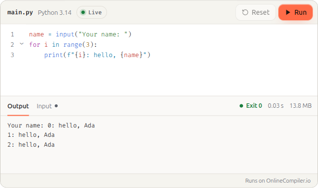
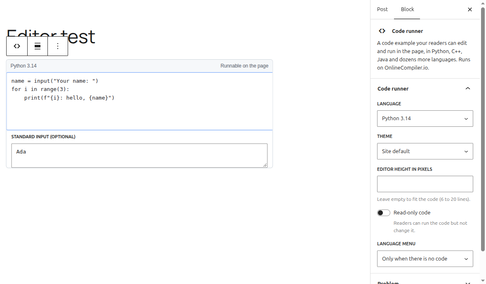

# OnlineCompiler.io Code Runner for WordPress

Code examples your readers can edit and run in the page, in Python, C++, Java, SQL and dozens more languages. Add a **Code runner** block, or the `[onlinecompiler]` shortcode in the classic editor, and readers get an editor with a Run button in your post. The code runs on [OnlineCompiler.io](https://onlinecompiler.io) in an isolated sandbox, not on your server.



## Install

1. Download this repository as a ZIP (**Code**, **Download ZIP**).
2. In WordPress, go to **Plugins**, **Add New Plugin**, **Upload Plugin**, choose the ZIP and activate it.
3. Create a free widget key on the [Widgets page](https://api.onlinecompiler.io/compilers/widgets/) of your OnlineCompiler.io dashboard (sign in with Google). Set its allowed domain to your site's domain.
4. Paste the key in **Settings**, **OnlineCompiler.io**.

Requires WordPress 6.3 or later and PHP 7.4 or later.

## Use it

**Block editor:** add a **Code runner** block, write the code and, if the program reads input, its standard input. The sidebar sets the language, theme, height, read-only code and the language menu. Put a stored problem's id under **Problem** to show that problem, with its statement and tests, instead.



**Shortcode:**

```
[onlinecompiler lang="python" stdin="Ada"]
name = input()
print(f"Hello, {name}")
[/onlinecompiler]
```

| Attribute | What it does |
|---|---|
| `lang` | A compiler id (`python-3.14`, `g++-15`) or a short name (`python`, `cpp`, `java`, `js`, `sql`). The site default if left out. |
| `stdin` | The program's starting input; `\n` for a new line. |
| `theme` | `auto`, `light` or `dark`. |
| `height` | The editor's height in pixels. |
| `readonly` | `1` so readers can run the code but not change it. |
| `lang_select` | `true` or `false` to show or hide the language menu. |
| `problem` | The id of a problem stored in your account. |
| `locale` | `pt` or `es` for the buttons and messages. |

For code full of `<` and `&`, use the block: the classic editor can change such code when it saves.

## How it works

The plugin writes the markup the [OnlineCompiler.io widget](https://onlinecompiler.io/docs/widget) reads (a `div` with class `runcode` holding the code in a `pre`) and loads `https://onlinecompiler.io/widget.js` on the pages that have one. The block is rendered on the server from its attributes, so WordPress's text filters never touch the code. The code is in the page as text before the widget loads, so search engines index it.

What is sent where is listed under "External services" in [readme.txt](readme.txt).

## Files

| File | |
|---|---|
| `onlinecompiler.php` | Plugin header; registers the widget script |
| `includes/render.php` | The HTML of one code runner, shared by the block and the shortcode |
| `includes/block.php`, `blocks/code-runner/` | The block: `block.json`, and an editor script in plain JavaScript (no build step) |
| `includes/shortcode.php` | `[onlinecompiler]`, which undoes what the classic editor does to code |
| `includes/settings.php` | Settings, OnlineCompiler.io |
| `includes/languages.php` | The compiler ids, copied from [the compiler list](https://onlinecompiler.io/docs/compilers) |

## License

GPL-2.0-or-later. See [LICENSE](LICENSE).
